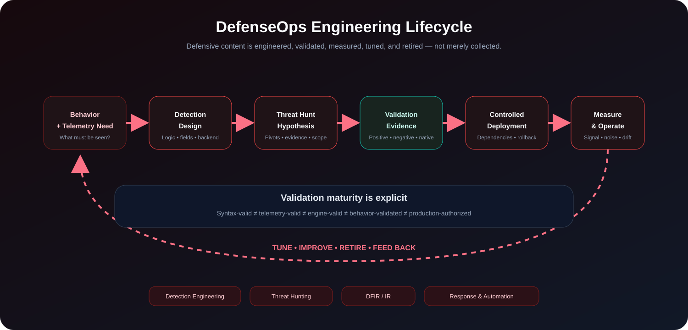

<h1 align="center">Cyber-Sentinel DefenseOps</h1>
<p align="center"><strong>Evidence-Driven Cyber Defense Engineering</strong></p>
<p align="center">DEFEND • DETECT • HUNT • VALIDATE • RESPOND • AUTOMATE</p>

<p align="center">
  <a href="https://github.com/cyber-sentinel/Cyber-Sentinel-DefenseOps/actions/workflows/repository-hygiene.yml"></a>
  
  
  
  
</p>

DefenseOps is the **DEFEND** layer of the Cyber-Sentinel ecosystem: a production-aware engineering system for building, validating, operating, and improving detections, threat hunts, DFIR/IR content, response engineering, deception-oriented controls, and security automation.

> **Core question:** **What can we detect, hunt, validate, and defend — and what evidence supports that claim?**

DefenseOps is deliberately not a rule dump. Defensive content is treated as an engineering artifact with explicit telemetry requirements, backend identity, validation evidence, limitations, tuning considerations, and rollback boundaries.

## Current State

| Boundary | State |
| --- | --- |
| Engineering baseline | **`0.1.0` — stable repository baseline** |
| GitHub Release / tag | **Not published** |
| Detection model | Multi-engine / backend-explicit |
| Validation posture | Syntax + native-engine checks + synthetic behavior evidence where applicable |
| Primary use | Authorized defensive engineering, hunting, DFIR/IR, validation, automation |
| Public production certification | **Not claimed** |
| Project license | **Not currently published** |

A passing CI check is evidence that a defined repository contract passed. It is **not** automatic authorization to deploy content into every tenant, sensor, endpoint, or production environment.

## Engineering Review Snapshot — 2026-10-25

The public `main` remains the `0.1.0` repository engineering baseline; that is **not** a product release or a blanket approval to run provider jobs.

- [Governed agent-instructions Draft PR #13](https://github.com/cyber-sentinel/Cyber-Sentinel-DefenseOps/pull/13), exact head `83e9cfd1bb06766be40f6bd51a3da9bb9e91b5ff`, proposes the project-owned `AGENTS.md`. [Repository Hygiene run #39992078480](https://github.com/cyber-sentinel/Cyber-Sentinel-DefenseOps/actions/runs/39992078480) succeeded at that head.
- The committed `main` baseline does **not yet contain** this proposed `AGENTS.md`; do not treat an untracked overlay as an approved repository trust binding. Even after an owner-authorized merge, any consuming system must verify the *new* exact trusted base and bundle before accepting project-specific execution.
- Detection/hunt content validation, real vendor-engine behavior, site telemetry mapping and Production execution approval remain distinct. A green Repository Hygiene workflow does **not** close these gates.
- Multi-project Orchestrator execution is managed through a separate, private control boundary; this public product repository does not authorize job dispatch, privilege delegation or Production canaries.

## What DefenseOps Owns

| Domain | Engineering responsibility |
| --- | --- |
| **Detection Engineering** | rules, queries, packs, metadata, telemetry prerequisites, tuning and validation |
| **Threat Hunting** | hypotheses, hunt queries, pivots, evidence requirements, Hunt → Detection feedback |
| **DFIR / IR Engineering** | investigation and response-oriented engineering material |
| **Validation** | positive/negative fixtures, conformance checks, engine-aware testing, maturity evidence |
| **Response Engineering** | bounded defensive actions, dependencies, rollback and operational constraints |
| **Deception** | deception-oriented defensive assets and validation context |
| **Automation** | traceable defensive workflows with explicit decision and rollback boundaries |

DefenseOps does **not** own ATLAS canonical knowledge or Skills operational-procedure authority.

## Engineering Lifecycle

<p align="center">
  
</p>

The lifecycle is evidence-driven. Syntactic validity, behavioral validation, and production approval are separate states.

## Detection & Hunting Coverage

### Windows PowerShell & LOLBins Detection Pack

[`detections/windows/powershell-lolbins/`](./detections/windows/powershell-lolbins/)

Multi-engine defensive coverage includes, where technically applicable:

`Sigma` • `Splunk SPL` • `Microsoft KQL` • `Microsoft Defender XDR` • `Elastic KQL/EQL/ES|QL` • `OpenSearch Query DSL` • `CrowdStrike Falcon LogScale CQL` • `SentinelOne` • `Wazuh XML` • `Google SecOps YARA-L` • `YARA` • `Suricata` • `Snort 3` • `Zeek`

### Windows PowerShell & LOLBins Threat Hunting Pack

[`threat-hunting/windows/powershell-lolbins/`](./threat-hunting/windows/powershell-lolbins/)

The hunting model emphasizes:

- hypothesis-driven hunts;
- backend-specific queries;
- evidence collection and pivots;
- false-positive and blind-spot analysis;
- Hunt → Detection promotion;
- explicit assumptions rather than hidden tenant dependencies.

## Validation Model

| Capability | Evidence | Current quality level |
| --- | --- | ---: |
| Sigma rules | Sigma CLI / strict validation | Q2 |
| YARA rules | native `yarac` compilation | Q2 |
| Suricata rules | native `suricata -T` validation | Q2 |
| Zeek scripts | native Zeek load validation | Q2 |
| Snort 3 rules | native `snort -T` validation | Q2 |
| Canonical Windows detection behavior | positive + negative synthetic fixtures | Q3 |
| Threat-hunting content | structural/content validation | Q1 |
| Vendor-specific SIEM/EDR queries | static/schema-aware review | Q1 |

Reference authorities:

- [Quality Model](./docs/quality-model.md)
- [Engine Validation Matrix](./docs/engine-validation-matrix.md)
- [Detection Engine & Language Registry](./docs/detection-engine-registry.md)
- [Changelog](./CHANGELOG.md)

## Engineering Standard

A substantive defensive artifact should document, where applicable:

1. objective and defensive use case;
2. threat / behavior / ATT&CK context;
3. required telemetry and prerequisites;
4. engine, platform, data model, and query/rule language;
5. detection, hunt, deception, response, or automation logic;
6. validation level and evidence;
7. expected false positives, blind spots, and limitations;
8. performance and production considerations;
9. rollback, disable, or recovery procedure;
10. references, attribution, and version history.

Backend identity must be explicit. Labels such as **KQL** alone are avoided because Microsoft Kusto Query Language, Elastic KQL, and other query dialects are not interchangeable.

## Enterprise Use Cases

DefenseOps is designed to support:

- Detection-as-Code programs;
- threat-hunting engineering libraries;
- SIEM/EDR migration and query-portability work;
- purple-team validation;
- incident-driven detection improvement;
- DFIR → Detection feedback;
- defensive regression testing;
- control validation;
- traceable security automation;
- SOC engineering standardization across teams or business units.

## Production Boundary

Before deployment, validate at minimum:

- telemetry availability and field mappings;
- platform and engine versions;
- positive and negative behavior;
- false-positive and performance impact;
- permissions and execution context;
- rollback / disable procedures;
- normal organizational change control.

Repository content is not automatic authorization to change production state.

## Cyber-Sentinel Ecosystem

```text
ATLAS       — KNOW   → Connect • Search • Investigate • Explain
DefenseOps  — DEFEND → Detect • Hunt • Validate • Respond • Automate
Skills      — APPLY  → Execute • Review • Reuse • Govern
AION        — INTERACT → Visualize • Listen • Speak • Adapt
```

### ATLAS — KNOW

[Cyber-Sentinel ATLAS](https://github.com/cyber-sentinel/Cyber-Sentinel-Atlas) owns canonical cyber-defense knowledge, provenance, deterministic retrieval, investigation context, graph relationships, and verified offline knowledge delivery.

DefenseOps content may be promoted into ATLAS only through ATLAS source, provenance, validation, and trust boundaries. Repository origin alone never grants canonical authority.

### Skills — APPLY

[Cyber-Sentinel Skills](https://github.com/cyber-sentinel/Cyber-Sentinel-Skills) owns reusable operating procedures and governed playbooks. Skills may operationalize DefenseOps artifacts, but it does not silently redefine their engineering ownership or validation state.

### AION — INTERACT

[Cyber-Sentinel AION](https://github.com/cyber-sentinel/Cyber-Sentinel-AION) provides the bounded visual and bilingual interaction layer. It cannot grant detection deployment authority or rewrite DefenseOps evidence; product-specific results stay with the owning defensive engine.

## Product Maturity

The current `0.1.0` engineering baseline is inspectable and CI-backed, but:

- no GitHub Release/tag is currently published for the baseline;
- tenant-specific validation remains environment-dependent;
- vendor-native behavior may require compatible runtime/tenant verification;
- no project `LICENSE` is currently published;
- public visibility does not itself grant redistribution rights;
- release packaging must preserve evidence, compatibility, attribution, and rollback metadata.

This maturity model is intentional: **credibility follows evidence, not labels**.

## Product Direction

Near-term engineering priorities remain:

- broaden behaviorally validated multi-engine detections;
- deepen Hunt → Detection → Validation feedback;
- strengthen reusable DFIR/IR and response engineering;
- improve compatibility and telemetry requirement metadata;
- expand validation maturity without overstating production readiness;
- preserve clean integration contracts with ATLAS and Skills.

---

<p align="center"><strong>Cyber-Sentinel DefenseOps — DEFEND with evidence.</strong></p>
<p align="center"><sub>Maintained by Ali RahimDabagh</sub></p>
